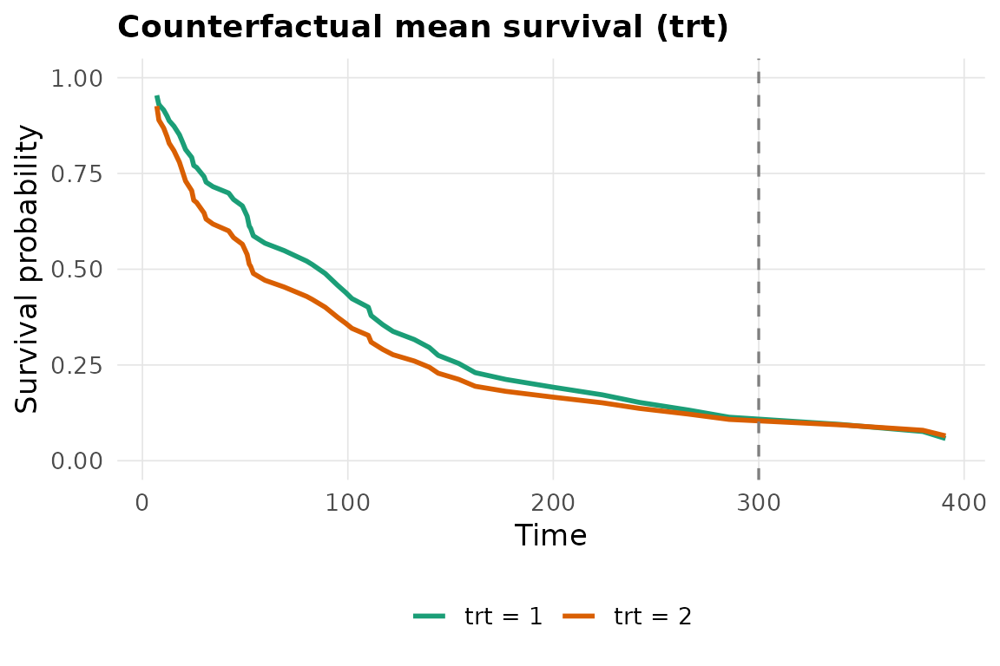

# Standardised treatment contrasts with estimate()

[`estimate()`](https://elbadisyimad.com/survalis/reference/estimate.md)
turns any survalis learner into a plug-in **G-computation**
(outcome-standardisation) estimator of a covariate-adjusted contrast
between the two levels of a binary treatment.

## What it computes

Given `formula = Surv(time, status) ~ x1 + x2` (the right-hand side
lists the **confounders**) and `treatment = "a"`,
[`estimate()`](https://elbadisyimad.com/survalis/reference/estimate.md):

1.  fits the working model `Surv(time, status) ~ a * (x1 + x2)` with the
    chosen learner,

2.  sets `a` to each level for **every** subject and predicts
    $`\hat S(t \mid X_i, a)`$,

3.  averages over subjects to get counterfactual mean curves
    $`\bar S_a(t) = n^{-1} \sum_i \hat S(t \mid X_i, a)`$,

4.  contrasts them into one of

    | `estimand`         | quantity                                            |
    |--------------------|-----------------------------------------------------|
    | `"RMST_diff"`      | $`\int_0^\tau \bar S_1 - \int_0^\tau \bar S_0`$     |
    | `"RMST_ratio"`     | $`\int_0^\tau \bar S_1 \big/ \int_0^\tau \bar S_0`$ |
    | `"survival_diff"`  | $`\bar S_1(\tau) - \bar S_0(\tau)`$                 |
    | `"survival_ratio"` | $`\bar S_1(\tau) \big/ \bar S_0(\tau)`$             |

## Example

``` r

library(survalis)

est <- estimate(
  Surv(time, status) ~ age + karno + celltype, data = veteran,
  model = "coxph", estimand = "RMST_diff",
  treatment = "trt", tau = 300,
  R = 100, seed = 1
)
est
#> <survalis_estimate> RMST difference at tau = 300  (model: coxph)
#>   treatment: trt  (2 vs 1)
#>   estimate: -14.3905   95% CI [-37.9061, 7.8690]   (100 bootstrap, refit)
#>   plug-in G-formula; causal reading needs exchangeability, positivity,
#>   consistency, no interference and a correct outcome model.
```

``` r

plot(est)
```



## Inference

The confidence interval is a nonparametric **subject bootstrap**. By
default (`refit = TRUE`) the working model is refitted inside every
replicate, so the interval reflects model-estimation error as well as
sampling variability. For an expensive learner you can set
`refit = FALSE` to get an interval that is *conditional on the fitted
model* – faster, but narrower than it should be.

``` r

summary(est)
#>    estimand tau  estimate  conf_low conf_high model
#> 1 RMST_diff 300 -14.39048 -37.90613  7.868977 coxph
```

## Assumptions

[`estimate()`](https://elbadisyimad.com/survalis/reference/estimate.md)
is a **plug-in G-formula** estimator. It is *not* doubly robust and
carries no protection against outcome-model misspecification beyond the
treatment-by-confounder interactions it adds automatically. The estimate
has a causal interpretation only under:

- **consistency** – the observed outcome equals the potential outcome
  under the treatment actually received;
- **no unmeasured confounding** given the covariates in `formula`;
- **positivity** – both treatment levels are possible for every
  covariate pattern;
- **no interference** between subjects;
- a **correctly specified** outcome model.

For a non-manipulable attribute (sex, a biomarker), read the result as a
covariate-adjusted marginal contrast, not an effect.
